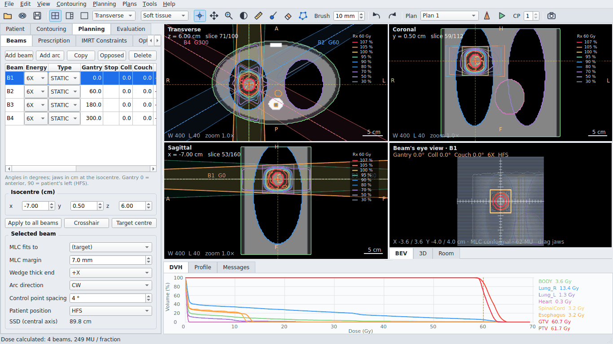
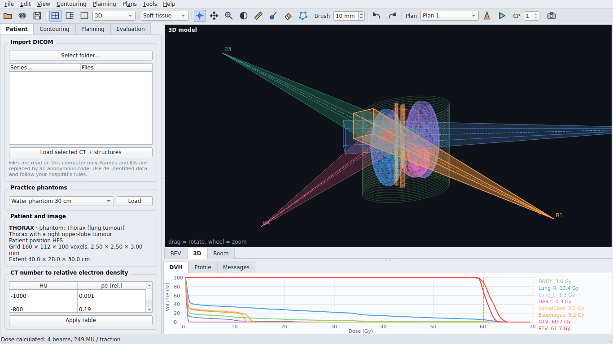
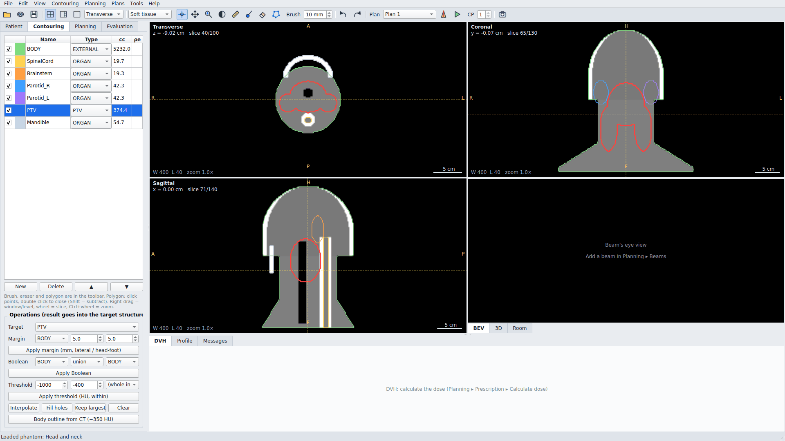
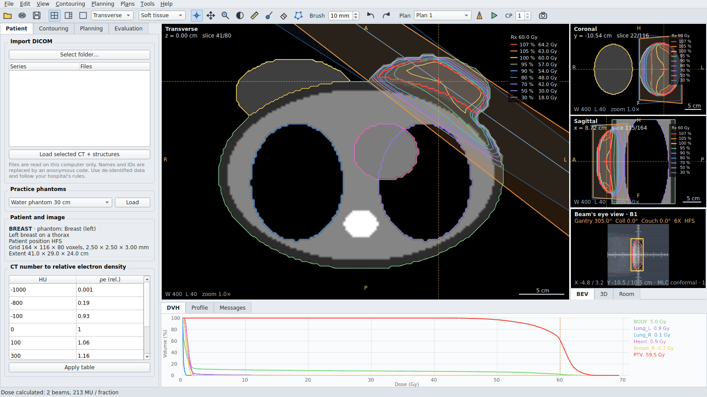
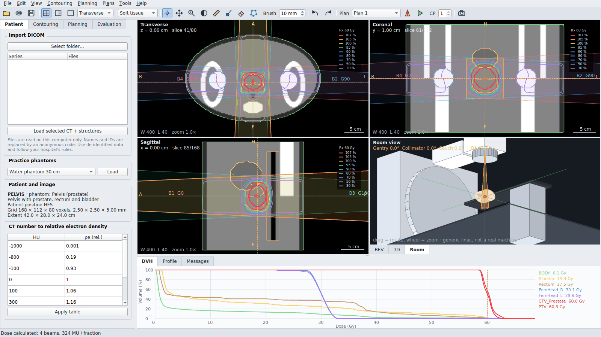
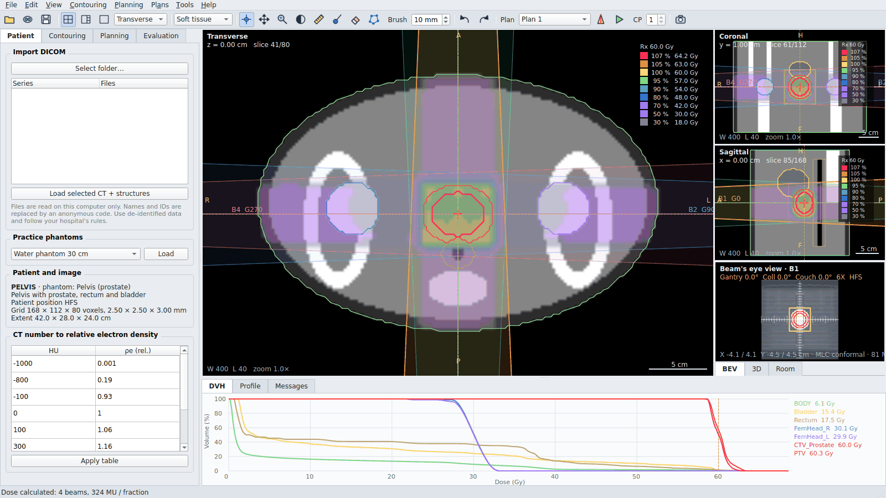
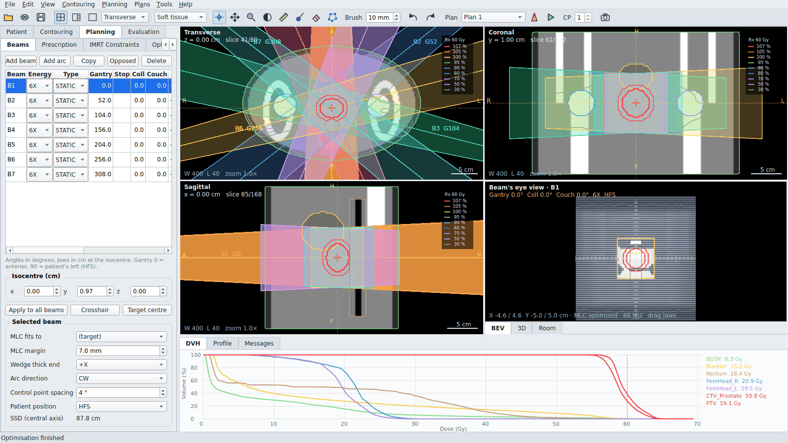
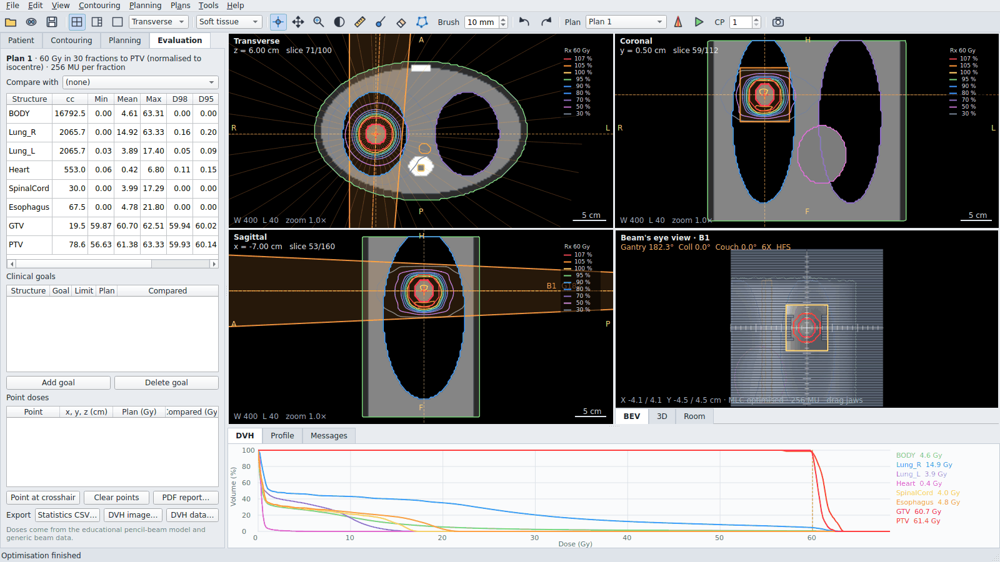
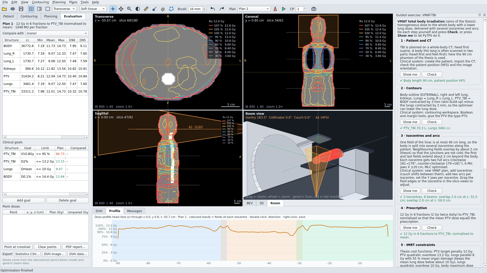

# PyTPS User Manual

**PyTPS 0.2.2 · educational radiotherapy treatment planning system**

Developed by **Kazim Radfar**, PhD student in Medical Physics.
Open source under the MIT licence. Source code: https://github.com/kazimradfar/PyTPS

> **Not for clinical use.** PyTPS is a teaching program. It is not a medical device, it is not commissioned for any
> treatment machine, and its beam data are generic teaching values. Never use it to plan, check or deliver a
> patient treatment.

**Contents**

1. About this manual
2. Intended use and safety
3. Installation and start
4. The main window
5. Viewing images
6. Patient workspace
7. Contouring
8. Beams
9. Prescription and dose calculation
10. Dose display
11. IMRT constraints
12. Optimisation
13. Plan evaluation
14. Plans
15. Export, reports and DICOM RT
16. Beam data and the dose model
17. Guided exercise: VMAT-TBI
18. Worked examples
19. Keyboard and mouse reference
20. Coordinate systems and conventions
21. Troubleshooting
22. Known limitations
23. Glossary
24. Licence, credits and citation

In the program this manual opens with **Help ▸ User manual** (Shift + F1). Choose a chapter on the left; the search
field finds a word in all chapters (press Enter again for the next match).

## 1. About this manual

This manual describes every workspace, menu and tool of PyTPS and the planning workflow it teaches. It is written for
MSc students of medical physics and for their teachers. Chapters 4 to 15 follow the order of a planning session:
patient → contours → beams → prescription → dose → optimisation → evaluation → export. Chapter 17 is a complete
exercise (whole-body VMAT for total body irradiation) and chapter 18 has shorter exercises.

Conventions used in this manual:

- **Menu ▸ Item** means: open the menu and choose the item, for example **Planning ▸ Calculate dose**.
- Names of buttons and fields are written in **bold**; keys are written as F5, Ctrl + Z.
- *Clinical system* notes explain how the same step is usually done in a commercial planning system, so that the
  student knows what to expect there.
- All screenshots show the synthetic practice phantoms of PyTPS, not patient images.

## 2. Intended use and safety

**Intended use.** PyTPS is used to learn the steps of external-beam treatment planning: image import, contouring,
beam placement, forward planning (3D conformal), inverse planning (IMRT and VMAT), dose evaluation and plan
comparison. It helps students to practise before they work with a clinical planning system.

**Not intended.** PyTPS must not be used for the treatment of patients, for patient-specific quality assurance, for
monitor-unit checks of clinical plans, or for any decision about a patient.

**Why the dose is not clinical.** The dose engine is a simplified pencil-beam model (chapter 16). Heterogeneities
change only the radiological depth, the beam data are generic, there is no couch or support model, and the
optimiser does not model all limits of a real linac. Dose differences of several per cent to a clinical system
are expected, and larger differences occur in lung and near interfaces.

**Patient data.** DICOM files are read on your own computer only. When a CT is loaded, the patient name and
identifiers are replaced by an anonymous code (`ANON-…`). Use de-identified data and follow the rules of your
institution and its ethics committee. Do not publish screenshots that show patient images without permission.

**Exported DICOM.** RT Plan, RT Dose and RT Structure Set files written by PyTPS are labelled as educational.
Do not import them into a clinical treatment system.

## 3. Installation and start

### 3.1 Requirements

- Windows 10 or 11 (64-bit) for the setup program; or any computer with Python 3.10 or newer (Windows, Linux, macOS)
  to run from source.
- 8 GB of memory is enough for the phantoms and for a pelvis or thorax CT on a 4 mm dose grid (1–2 GB in use).
  Whole-body CTs need 8 mm grids or more memory.
- A screen of at least 1366 × 768 pixels; 1920 × 1080 is more comfortable.

### 3.2 Windows setup program

1. Open https://github.com/kazimradfar/PyTPS/releases/latest and download `PyTPS_Setup_vx.y.z.exe`.
2. Run it. It installs for the current user only and needs no administrator rights.
3. The program is not code-signed, so Windows SmartScreen may say *unknown publisher*: choose **More info ▸ Run anyway**.
4. Start PyTPS from the Start menu. Uninstall it from Windows **Settings ▸ Apps**.

The portable version (`PyTPS_portable.zip`) needs no installation: unzip it and start `PyTPS\PyTPS.exe`.

### 3.3 Run from source

```
git clone https://github.com/kazimradfar/PyTPS.git
cd PyTPS
python -m pip install -r requirements.txt
python run_pytps.py
```

`run_pytps.py` must be started from the `PyTPS` folder (or give its full path). `python -m pytps` does the same.
To update later: `git pull` in the `PyTPS` folder.

Easier on Windows: double-click `start_pytps.bat`. The first start creates a private Python environment (`.venv`)
in the folder and installs everything PyTPS needs (internet needed once); later starts are quick.
On Linux or macOS use `./start_pytps.sh`. With `pip install .` PyTPS is installed as a package and started with
the command `pytps`.

### 3.4 Command-line options

| Option | Meaning |
|---|---|
| `--phantom NAME` | load a practice phantom, e.g. `"Thorax (lung tumour)"` |
| `--dicom FOLDER` | load the CT and structures of a DICOM folder |
| `--layout 4`, `1+3`, `1` | view layout at start |
| `--main-view NAME` | main view: Transverse, Coronal, Sagittal, BEV, 3D or Room |
| `--workspace NAME` | Patient, Contouring, Planning or Evaluation |
| `--demo-plan ANGLES` | add static beams at these gantry angles and calculate, e.g. `0,90,180,270` |
| `--arc` | with `--demo-plan`: one arc instead of static beams |
| `--optimise N` | with `--demo-plan`: optimise with N Stage 1 iterations |
| `--dose-mode MODE` | lines, wash, difference or off |
| `--guide-tbi` | open the VMAT-TBI exercise and do its steps (demonstration) |
| `--size WxH` | window size, e.g. `1600x900` |
| `--self-test FILE` | short automatic check of the installation; writes a JSON report |

Example: `python run_pytps.py --phantom "Pelvis (prostate)" --demo-plan 0,52,104,156,204,256,308 --optimise 80`

### 3.5 Self-test

`PyTPS.exe --self-test result.json` loads the pelvis phantom, optimises a three-beam plan and checks that the mean
target dose is within 5 % of the prescription. The exit code is 0 when the test passed. The Windows release is
tested this way before it is published.

## 4. The main window



| Area | Contents |
|---|---|
| Menu bar | File, Edit, View, Contouring, Planning, Plans, Tools, Help |
| Toolbar | import, phantom, export; view layouts and main view; window/level preset; tools (crosshair, pan, zoom, window/level, measure, brush, eraser, polygon) and brush size; undo/redo; current plan; add beam; calculate; control point of an arc; screenshot |
| Workspaces (left) | **Patient**, **Contouring**, **Planning** (Beams, Prescription, IMRT Constraints, Optimisation), **Evaluation** |
| Image views (centre) | transverse, coronal and sagittal slices and a fourth view with the tabs **BEV**, **3D** and **Room** |
| Lower area | **DVH**, **Profile** (dose along a line) and **Messages** (log of the session) |
| Status bar | last message and values under the mouse |

The splitters between the areas can be dragged. The four views are linked: a click in one view moves the crosshair
and the other views follow.

### 4.1 Menus

- **File**: import DICOM folder (Ctrl + O), load practice phantom, export RT Structure Set (Ctrl + E),
  **Export image / data** (main view image, window image, DVH image and CSV, statistics CSV, dose profile image and CSV), exit.
- **Edit**: undo (Ctrl + Z) and redo (Ctrl + Y) of contouring steps.
- **View**: layouts, **Main view**, dose colour bar / isodose legend, window/level presets, reset zoom (Ctrl + 0).
- **Contouring**: new structure (Ctrl + N), delete, interpolate, fill holes, keep largest part, body outline from CT.
- **Planning**: add beam (Ctrl + B), add arc, add opposed beam, isocentre to target centre, prescription,
  IMRT constraints, calculate dose (F5), optimise (F6), dose display, show beams in the slices.
- **Plans**: new, copy, rename, delete, plan sum, export/import RT Plan and RT Dose, PDF plan report.
- **Tools**: measure distance, beam data and model.
- **Help**: user manual (Shift + F1), guided exercise VMAT-TBI (F1), about PyTPS.

## 5. Viewing images

### 5.1 Layouts and the main view

Three layouts are available in **View** and in the toolbar:

- **2 × 2 views**: transverse, coronal, sagittal and the beam views.
- **One large + three small**: the main view is large on the left.
- **Single view**: only the main view is shown.

The **main view** is chosen in the toolbar list next to the layout buttons, in **View ▸ Main view** (Alt + 1 … Alt + 6),
or by clicking into a view. The list contains **Transverse, Coronal, Sagittal, BEV, 3D and Room**, so the
beam's-eye view, the 3D model or the treatment room can also fill the whole image area.



### 5.2 Navigation

| Action | Mouse / key |
|---|---|
| Move the crosshair (all views follow) | left click with the crosshair tool |
| Next / previous slice | mouse wheel, ↑ / ↓, Page Up / Page Down; Shift + wheel = 5 slices |
| Zoom | Ctrl + wheel, or the zoom tool (drag up / down) |
| Pan | middle button drag, or the pan tool |
| Window / level | right button drag, the window/level tool, or the presets list |
| Reset zoom and pan | View ▸ Reset zoom (Ctrl + 0) |
| Measure a distance | measure tool, drag from point to point |

Each slice view shows its name, the slice position and number, window and level, the zoom factor, the
orientation letters (R/L, A/P, H/F) and a 5 cm scale bar.

### 5.3 Window / level presets

Soft tissue, lung, bone, brain and others are in the toolbar list and in **View ▸ Window / level**.
Lung needs a wide window around −600 HU; bone a high level.

## 6. Patient workspace

### 6.1 Import DICOM

1. **File ▸ Import DICOM folder…** (or **Select folder…** in the Patient workspace). Choose a folder; sub-folders are searched.
2. The list shows the CT series, RT Structure Sets, RT Plans and RT Doses that were found.
3. Select the CT series and press **Load selected CT + structures**. A structure set that refers to the CT is loaded with it.

Notes:

- The CT must be axial. Oblique or tilted series are refused.
- Very large series (more than about 40 million voxels) are resampled to a coarser grid to save memory.
- The patient position (HFS, FFS, HFP, FFP) is read from the CT and used for the beam geometry.
- RT Plan and RT Dose files are imported from the **Plans** menu after the CT (chapter 15).

*Clinical system:* the CT is usually sent from the CT scanner or the PACS to the planning system; the patient is
created first, then the image is imported and its orientation and the CT-to-density table are checked.

### 6.2 Practice phantoms

Without patient data, load a phantom (**File ▸ Load practice phantom** or the list in the Patient workspace):

| Phantom | Structures | Use |
|---|---|---|
| Water phantom 30 cm | water box | beam data, PDD and profiles |
| Thorax (lung tumour) | body, lungs, heart, spinal cord, oesophagus, GTV, PTV | lung heterogeneity, 3D conformal, VMAT |
| Pelvis (prostate) | body, CTV, PTV, rectum, bladder, femoral heads | four-field box, IMRT |
| Head and neck | body, PTV, spinal cord, brainstem, parotids, mandible | IMRT / VMAT with many organs |
| Breast (left) | body, breast PTV, lungs, heart, right breast | tangential fields, wedges |
| Whole body 90 cm (TBI) | body, lungs, kidneys, PTV | multi-isocentre VMAT-TBI (chapter 17) |

### 6.3 CT-to-density table

The table converts Hounsfield units to relative electron density for the dose calculation. Edit the values and press
**Apply table**. The default table is a generic one; a clinical system uses a table measured for its CT scanner.
Exercise: change the lung values and see how the dose behind the lung changes.

## 7. Contouring



### 7.1 Structure list

The table lists all structures: visibility, colour, name, type, volume (cc) and density override (ρe).

- **New** creates an empty structure; **Delete** removes the selected one; ▲ ▼ change the order (the order is also
  used for layering in the optimiser).
- Click the colour to change it. Types: EXTERNAL, PTV, CTV, GTV, ORGAN, AVOIDANCE, SUPPORT, MARKER, CONTROL.
  One structure should be EXTERNAL (body outline): the dose is calculated inside it.
- **Density override**: a fixed relative electron density for the structure (e.g. 1.0 for a contrast-filled
  bladder, or for a prosthesis region set to its known density).

### 7.2 Drawing tools (toolbar)

| Tool | Use |
|---|---|
| Brush | paints the selected structure on the current slice; size in the toolbar (mm) |
| Eraser | removes the selected structure on the current slice |
| Polygon | click points; double-click or right-click to close; with Shift the polygon is subtracted |

Undo (Ctrl + Z) and redo (Ctrl + Y) work for all drawing steps and operations.

### 7.3 Operations

The result of each operation goes into the structure chosen as **Target** (create it first with **New**).

- **Margin**: source structure, lateral margin and head-foot margin in mm; negative values contract.
  Example: PTV = CTV + 7 mm, 5 mm head-foot.
- **Boolean**: union, intersect, subtract or xor of two structures. Example: PTV_eval = PTV subtract (BODY contracted by 3 mm).
- **Threshold**: voxels between two HU values, optionally only within a structure (e.g. bone inside the body).
- **Interpolate**: fills the slices between contoured slices.
- **Fill holes**, **Keep largest**, **Clear**.
- **Body outline from CT (−350 HU)**: automatic EXTERNAL contour.

**File ▸ Export RT Structure Set** writes the structures as DICOM.

*Clinical system:* contours are often drawn on every second or third slice and interpolated; margins are made with a
3D margin tool, never by hand.

## 8. Beams



### 8.1 Beam table (Planning ▸ Beams)

**Add beam** adds a static field at the isocentre, **Add arc** an arc, **Copy** copies the selected beam, **Opposed**
adds the parallel-opposed beam and **Delete** removes it. The table has one row per beam:

| Column | Meaning |
|---|---|
| Beam | name (editable) |
| Energy | 6X or 10X |
| Type | STATIC or ARC |
| Gantry, Stop | gantry angle; for arcs the start and stop angle (degrees, IEC) |
| Coll, Couch | collimator and couch angles |
| X1, X2, Y1, Y2 | jaw positions at the isocentre plane in cm (X1, Y1 negative on the minus side) |
| MLC | open, conformal (to a structure with a margin), manual (edited in the BEV) or optimised (by the optimiser) |
| Wedge | none or a physical wedge angle; the thick end is set below the table |
| Weight | relative weight in the MU normalisation |
| MU | monitor units per fraction after the calculation |

Below the table:

- **Isocentre (cm)**: type x, y, z, or press **Crosshair** or **Target centre**; **Apply to all beams** gives every beam this isocentre.
- **MLC fits to** and **MLC margin** for conformal leaves.
- **Wedge thick end**, **Arc direction** (CW / CCW), **Control point spacing** of arcs.
- **Patient position** (HFS, FFS, HFP, FFP) and the **SSD** on the central axis.

### 8.2 Editing fields with the mouse

In the transverse, coronal and sagittal views (crosshair tool):

- Point at a **field edge**: the cursor changes to ↔ or ↕. Drag to make the field wider or narrower. The jaw moves
  in 1 mm steps; the status bar shows the jaw positions and the field size.
- Drag the **red isocentre cross** to move the isocentre. All beams that share it move together and arcs keep their
  MLC (like a set-up shift).
- **Rotate the gantry:** in the transverse view the selected beam has a round **gantry handle** on its central axis
  (labelled *G 45°*). Point at it (open hand), drag it around the isocentre and the gantry follows in 1° steps, or
  5° steps with Shift held. An arc has a second, square handle for its stop angle. The handle appears in the
  view in which the gantry rotates: the transverse view at couch 0°, another view when the couch is turned.
- The **Gantry dial** in *Selected beam* (Beams tab) does the same: turn it with the mouse or the wheel, or type the
  angle next to it. 0° is at the top of the dial.
- Changing the gantry, the jaws or the isocentre removes the dose of that beam; press **Calculate** (F5) again.
- In the **BEV**, drag the jaws or the MLC leaves (leaf editing sets the MLC to *manual*).

### 8.3 Beam's-eye view (BEV)

The BEV shows the patient as seen from the source: a digitally reconstructed radiograph (DRR), the projected
structures, the jaws and the MLC. For arcs, the **CP** box in the toolbar selects the control point.

### 8.4 3D view

A 3D model of the body, the structures and the beams (divergent fields, arcs as fans). Drag to rotate, wheel to zoom.

### 8.5 Room view

A generic treatment room: linac stand and rotating gantry with collimator and imager, couch with its rotation,
the patient, the room lasers and the current beam. It follows the gantry, collimator and couch angles of the
selected beam and control point. Use it to check that the couch and gantry angles make sense and to imagine
collisions (PyTPS does not check collisions). Drag to rotate, wheel to zoom.



## 9. Prescription and dose calculation

### 9.1 Prescription (Planning ▸ Prescription)

| Field | Meaning |
|---|---|
| Total dose, Fractions | e.g. 60 Gy in 30 fractions; the dose per fraction is shown below |
| Target | the structure the prescription refers to (default: the PTV) |
| Normalise to | **isocentre** (dose at the isocentre), **mean**, **D95** or **D50** of the target |
| Prescription isodose | e.g. 95 %: the chosen point or volume receives this percentage of the dose |
| Dose grid | voxel size of the dose calculation (2–10 mm); 4 mm is a good default, 6–8 mm for long bodies |

Press **Calculate dose** (F5). PyTPS calculates the dose per MU of each beam, scales the MU so that the prescription
is met with the given beam weights, and updates all views, the DVH and the statistics.

### 9.2 Monitor units

The machine is calibrated to give 1 cGy per MU at the depth of maximum dose for a 10 × 10 cm field at SSD 100 cm.
The MU of each beam follow from its weight, depth, field size (output and head-scatter factors), wedge and
inverse-square factor. The MU per fraction are shown in the beam table and in the PDF report.

## 10. Dose display

**Planning ▸ Dose display** offers four modes:

- **Isodose lines**: 107, 105, 100, 95, 90, 80, 70, 50 and 30 % of the prescription.
- **Colour wash**: coloured bands between the same levels.
- **Difference to the compared plan**: red where the current plan is hotter, blue where it is colder (±10 % of the
  prescription); choose the compared plan in **Evaluation ▸ Compare with**.
- **Off**.

In every slice view a **colour bar** (wash) or **isodose legend** (lines) is shown at the top right, with each level in
per cent and in Gy of the prescription (small views show the per cent values only). In the difference mode the bar
shows the scale from −10 % to +10 %.
Hide or show it with **View ▸ Dose colour bar / isodose legend**.



**Show beams in the slices** (Planning menu) switches the field outlines on and off.

## 11. IMRT constraints

Inverse planning starts from cost functions (**Planning ▸ IMRT Constraints**). **Defaults** gives a starting set for the
target and the organs in the structure list; **Add** and **Delete** edit it. Each row has the structure, the cost
function, two parameters, a weight, the mode and the achieved value after optimisation.

| Cost function | Parameter 1 | Parameter 2 | Use |
|---|---|---|---|
| Target Penalty | prescription (Gy) | min. volume (%) | coverage of the target |
| Target EUD | EUD (Gy) | cell sensitivity α (1/Gy) | biological coverage; penalises cold spots |
| Quadratic Underdose | dose (Gy) | RMS (Gy) | no voxel below the dose |
| Underdose DVH | dose (Gy) | min. volume (%) | at least x % above the dose |
| Quadratic Overdose | dose (Gy) | RMS (Gy) | hot spots in targets and organs |
| Overdose DVH | dose (Gy) | max. volume (%) | at most x % above the dose |
| Maximum Dose | max. dose (Gy) | – | hard maximum (e.g. body, mandible) |
| Serial | EUD limit (Gy) | power k | serial organs (cord, brainstem, rectum): high k acts like a maximum dose |
| Parallel | reference dose (Gy) | mean organ damage (%) | parallel organs (lung, parotid, kidney) |
| Conformality | reference dose (Gy) | fall-off (mm) | steep dose fall-off around the target |

- **Objective**: traded off against the other cost functions with its weight.
- **Constraint**: its weight is increased while it is not met.
- **Layering** (Optimisation tab): overlapping voxels belong to the structure higher in the list.

*Clinical system:* the same families of cost functions exist (biological and physical); start with few cost
functions, optimise, look at the DVH, then add or tighten one at a time.

## 12. Optimisation

Only beams with **MLC = optimised** are optimised; other beams count as a fixed (bias) dose.

| Setting | Meaning |
|---|---|
| Stage 1 iterations | fluence optimisation steps |
| Stage 2 iterations | segment-weight optimisation steps |
| Fluence smoothing | off, low, medium, high (smoother fluence = fewer, larger segments) |
| IMRT intensity levels | levels of the step-and-shoot decomposition |
| Max. segments / beam, Min. segment area, Min. MU / segment | deliverability of step-and-shoot IMRT |
| VMAT apertures / sector, VMAT sector | apertures per arc sector and sector size (degrees) |
| Max. dose rate | used for the delivery-time estimate |

Buttons: **Stage 1 · fluence**, **Stage 2 · segments**, **Optimise (1 + 2)** (F6). A progress window can stop the run.

- **Stage 1** optimises the fluence map of each beam (static) or of each arc sector (VMAT) on the pencil-beam engine.
  The mean target dose is kept at the prescription during the optimisation.
- **Stage 2** converts the fluence into MLC apertures (intensity levels for IMRT, apertures per sector for VMAT),
  optimises the segment weights and recalculates the final dose with the full engine.
- The plot shows the total cost per iteration; the table shows MU per fraction, segments or control points and a
  rough delivery time per beam.



Tips: if the target coverage is poor, lower the weight of organ cost functions or raise the target weight; if an
organ is above its goal, tighten its cost function a little at a time. Very high weights make the optimisation slow
and the fluence noisy.

## 13. Plan evaluation



### 13.1 DVH (lower area)

Cumulative dose-volume histograms of all visible structures; the dashed vertical line marks the prescription.
The mean dose of each structure is listed on the right. Curves of the compared plan are dashed.
Right-click the DVH to save it as an image, copy it, or export the data (chapter 15).

### 13.2 Dose profile

The **Profile** tab shows the dose along a line through the crosshair: head–foot (default), right–left or
anterior–posterior; double-click to change the direction. Coloured bands mark the head–foot extent of the fields of
each isocentre, so cold or hot junctions between fields are easy to see. Right-click to save or export.

### 13.3 Evaluation workspace

- **Statistics** per structure: volume (cc), min, mean, max, D98, D95, D50, D2 and V95 % of the prescription.
- **Compare with**: choose a second plan (or an imported RT Dose); its values appear side by side and its DVH dashed.
- **Clinical goals**: add goals such as *PTV V95 % ≥ 95 %* or *Rectum D2 ≤ 70 Gy* (Dmean, Dmax, Dmin, Dx, Vx);
  each goal shows pass or fail for the plan and the compared plan.
- **Point doses**: add a point at the crosshair; the table shows its coordinates and dose.
- **Export**: statistics CSV, DVH image, DVH data; **PDF report**.

Useful goals (examples from common practice; check your institution's protocol): PTV V95 % ≥ 95 %, PTV D2 ≤ 107 %,
mean lung dose ≤ 20 Gy, cord maximum ≤ 45–50 Gy, rectum V70 ≤ 20 %.

## 14. Plans

A patient can have several plans (**Plans** menu and the plan list in the toolbar):

- **New plan**, **Copy plan** (to try a variation), **Rename plan**, **Delete plan**.
- **Plan sum**: a new plan with the summed dose of two plans on the same dose grid (e.g. phase 1 + boost).
- The current plan is selected in the toolbar list; the compared plan in Evaluation ▸ Compare with.

## 15. Export, reports and DICOM RT

### 15.1 Images

- **File ▸ Export image / data ▸ Main view as image** (Ctrl + Shift + P): the main view (slice, BEV, 3D or room) as PNG or JPEG.
- **Whole window as image** (Ctrl + P), also the camera button in the toolbar.

### 15.2 DVH and profile

- **DVH as image**: a PNG with a white background, title (plan, prescription), axes and legend, at twice the screen
  resolution, ready for reports and theses. Also from the Evaluation workspace (**DVH image…**) and the right-click
  menu of the DVH (**Save image**, **Copy image**).
- **DVH data (CSV)**: the cumulative DVH of every shown structure on a common dose axis (0.1 Gy steps for
  prescriptions of 10 Gy or more, 0.02 Gy below): column *Dose (Gy)* and one *volume (%)* column per structure; the
  compared plan's curves are added with its name in brackets. Open it in Excel or read it in Python or R.
- **Dose profile as image / data (CSV)**: position (cm) and dose (Gy) of the current and the compared plan.
- **Dose statistics (CSV)**: the statistics table.


### 15.3 PDF plan report

**Plans ▸ PDF plan report** (or **PDF report…** in Evaluation): patient code, prescription, beams with MU and SSD,
statistics, clinical goals, DVH and views, marked as educational.

### 15.4 DICOM RT

- **Export RT Plan**: beams, jaws (ASYMX/ASYMY), MLC, wedges, step-and-shoot segments, arc control points and MU.
- **Export RT Dose**: the dose on the dose grid.
- **Import RT Plan**: beams of a plan from another system; recalculated with the PyTPS beam model.
- **Import RT Dose (compare)**: the dose of another system, added as a plan for comparison with the PyTPS dose
  (DVH, statistics, difference display).

Comparing an imported clinical dose with the PyTPS dose of the same beams is a good exercise to understand the
limits of a pencil-beam model.

## 16. Beam data and the dose model

### 16.1 Beam data editor (Tools ▸ Beam data and model)

Tabs: **Depth dose** (PDD for several field sizes at SSD 100 cm), **Output and head scatter**, **Wedge factors**,
**Calibration and model**. Edit values, press fit, and compare the data with the model curves. Recalculate the
plans after a change. The values are generic, with the typical shape of 6 MV and 10 MV beams (PDD at 10 cm depth for
10 × 10 cm: about 66 % and 73 %).

*Clinical system:* beam data are measured during commissioning (water tank scans and output factors), entered into
the planning system and the model is fitted and verified; this tab shows the same idea in a simple form.

### 16.2 Dose calculation (pencil beam)

For each beam or control point:

1. the fluence at the isocentre plane is made from the jaws, the MLC (with leaf transmission) and the wedge;
2. it is convolved with a narrow Gaussian kernel (penumbra) and a broad exponential kernel (phantom scatter);
3. the radiological depth along each divergent ray is traced through the electron-density volume;
4. dose = k · MU · Sc · inverse-square factor · [P(d) · primary fluence + S(d) · scatter fluence],
   where P(d) and S(d) are depth functions fitted to the beam data.

Heterogeneities change only the radiological depth, not the lateral scatter. Therefore the dose in and behind lung
is less accurate than with convolution/superposition or Monte Carlo algorithms used in clinical systems.

## 17. Guided exercise: VMAT-TBI

**Help ▸ Guided exercise: VMAT-TBI** (F1) opens a panel on the right. It follows the planning steps of the thesis on
whole-body VMAT for total body irradiation. Each step explains what to do and how it is done in a clinical system;
**Show me** does the step, **Check** checks what you did yourself.



1. **Patient and CT**: the 90 cm whole-body phantom, head first supine.
2. **Contours**: Lungs = Lung_R ∪ Lung_L; PTV_TBI = BODY contracted by 3 mm minus the lungs contracted by 2 mm.
3. **Isocentres and arcs**: three isocentres (A head–thorax, B abdomen, C pelvis–thighs), fields overlapping by about
   2 cm and extending 2 cm beyond the body; two full arcs per isocentre, 6 MV, X jaws ±20 cm, MLC optimised.
   The check reports each overlap and any gap.
4. **Prescription**: 12 Gy in 6 fractions, normalised to the mean PTV dose, 8 mm dose grid.
5. **IMRT constraints**: PTV target penalty 12 Gy, PTV quadratic overdose 13.2 Gy, lungs parallel 8 Gy with 55 %
   mean organ damage, lungs quadratic overdose 10 Gy, body maximum 14.4 Gy.
6. **Optimisation**: about two to three minutes.
7. **Evaluation**: PTV V90 % ≥ 95 %, D2 % ≤ 13.2 Gy, mean lung dose ≤ 10 Gy, body D0.1 % ≤ 14.4 Gy; look at the dose
   profile along the body at each junction.
8. **Robustness**: copy the plan, shift isocentre B by 5 mm in the coronal view, recalculate (F5) and compare.

Questions for the student: How does a wider overlap change the sensitivity of the junction to a set-up error?
Which cost function controls the mean lung dose, and what does it cost in PTV coverage?

## 18. Worked examples

### 18.1 Four-field box, prostate (3D conformal)

1. Load *Pelvis (prostate)*.
2. Planning ▸ Beams: **Add beam** four times, gantry 0, 90, 180, 270; isocentre **at the target centre**.
3. MLC = conformal, MLC fits to PTV, margin 7 mm.
4. Prescription: 78 Gy / 39 fractions, normalise to the isocentre at 100 %. **Calculate dose**.
5. Evaluate PTV coverage and the rectum and bladder DVH; try weights and wedges; save the DVH image.

### 18.2 Lung VMAT

1. Load *Thorax (lung tumour)*; isocentre at the PTV centre.
2. **Add arc** (181° → 179°, CW), MLC = optimised.
3. Prescription: 60 Gy / 30 fractions, mean of the PTV.
4. IMRT Constraints ▸ **Defaults**; add lung Parallel and cord Serial if missing.
5. **Optimise (1 + 2)**; evaluate the mean lung dose, V20 and the cord maximum; compare with a 3D conformal plan.

### 18.3 Tangential breast fields

1. Load *Breast (left)*; add a beam at gantry about 305° and press **Opposed** for the second tangent (about 125°).
2. Adjust the gantry angle until the posterior field edges of both tangents line up in the BEV and the lung inside the
   field is small.
3. Add wedges (thick end anterior) and compare the hot spot with and without wedges.

## 19. Keyboard and mouse reference

| Key | Action |
|---|---|
| Ctrl + O | import DICOM folder |
| Ctrl + E | export RT Structure Set |
| Ctrl + P / Ctrl + Shift + P | save window / main view as image |
| Ctrl + Z / Ctrl + Y | undo / redo |
| Ctrl + N | new structure |
| Ctrl + B | add beam |
| Ctrl + 0 | reset zoom |
| Alt + 1 … Alt + 6 | main view: transverse, coronal, sagittal, BEV, 3D, room |
| F5 | calculate dose |
| F6 | optimise (Stage 1 + 2) |
| F1 / Shift + F1 | guided exercise / user manual |
| ↑ ↓, Page Up / Down | change slice |

| Mouse | Action |
|---|---|
| left click | crosshair (or the selected tool) |
| wheel / Shift + wheel | slice / 5 slices |
| Ctrl + wheel | zoom |
| middle drag | pan |
| right drag | window / level (polygon tool: close the polygon) |
| drag a field edge or the isocentre | resize the field / move the isocentre |
| drag the round gantry handle (transverse view) | rotate the gantry (Shift: 5° steps) |
| right click on DVH or profile | save image, copy image, export CSV |
| double click on the profile | change its direction |

## 20. Coordinate systems and conventions

- Patient coordinates are DICOM (LPS, mm): +x towards the patient's left, +y posterior, +z towards the head.
  The views show cm.
- Machine angles follow the IEC 61217 convention. For a head-first supine patient, gantry 0° is an anterior beam and
  gantry 90° enters from the patient's left. Check collimator and couch rotations in the BEV and the room view.
- Field coordinates X and Y are at the isocentre plane (SAD 100 cm). The MLC leaves move along X; 80 leaf pairs of
  5 mm cover 40 cm.
- Doses are in Gy for the whole course unless *per fraction* is written; MU are per fraction.

## 21. Troubleshooting

| Problem | Solution |
|---|---|
| `can't open file 'run_pytps.py'` | start it in the `PyTPS` folder: `cd PyTPS`, then `python run_pytps.py` |
| no module named PySide6 / pydicom | `python -m pip install -r requirements.txt` in the `PyTPS` folder |
| the CT is refused (oblique) | PyTPS reads axial CTs only; reconstruct the series axially |
| DVH empty | calculate the dose (F5); make sure the structure is visible |
| *Calculate the dose first* when exporting | the current plan has no dose yet |
| difference display shows nothing | choose a plan in Evaluation ▸ Compare with |
| optimisation does nothing | set MLC = optimised for the beams; add cost functions |
| slow calculation or out of memory | coarser dose grid (6–8 mm), fewer arcs, crop long CTs |
| SmartScreen warning on Windows | the program is not code-signed: More info ▸ Run anyway |
| `git fetch` reports *cannot lock ref* | another fetch (for example VS Code) ran at the same time; run the command again |

## 22. Known limitations

- Pencil-beam dose with depth-only heterogeneity correction; no electron transport; no couch or immobilisation model.
- Generic beam data; MU are not those of any real linac.
- The VMAT optimisation enforces leaf-speed and dose-rate limits only approximately; delivery times are estimates.
- No collision check in the room view.
- Imports of RT Plan and RT Dose from clinical systems are supported for common cases but have not been tested with
  every vendor's files.
- One CT per patient; no image registration.

## 23. Glossary

| Term | Meaning |
|---|---|
| BEV | beam's-eye view: the patient seen from the source |
| CP | control point of an arc or a segment |
| DRR | digitally reconstructed radiograph, calculated from the CT |
| DVH | dose-volume histogram |
| Dx, Vx | dose received by x % of the volume; volume receiving at least x Gy (or % of Rx) |
| EUD | equivalent uniform dose |
| HFS, FFS, HFP, FFP | head/feet first, supine/prone |
| IMRT | intensity-modulated radiotherapy (static gantry, step-and-shoot here) |
| MU | monitor units |
| PDD | percentage depth dose |
| PTV, CTV, GTV | planning, clinical and gross target volume |
| Rx | prescription dose |
| SAD, SSD | source-axis distance, source-skin distance |
| TBI | total body irradiation |
| VMAT | volumetric modulated arc therapy |

## 24. Licence, credits and citation

PyTPS was developed by **Kazim Radfar**, PhD student in Medical Physics, for the teaching of medical physics students.
It is released under the MIT licence (see the file `LICENSE`): you may use, copy, modify and share it, also in
courses, as long as the copyright notice is kept. There is no warranty of any kind.

Please cite it as: *Radfar K. PyTPS: an educational radiotherapy treatment planning system (version 0.2.2).
https://github.com/kazimradfar/PyTPS*

Bug reports and suggestions are welcome as GitHub issues in the repository. How to change the program yourself is
described in `docs/EDITING_GUIDE.md`.
